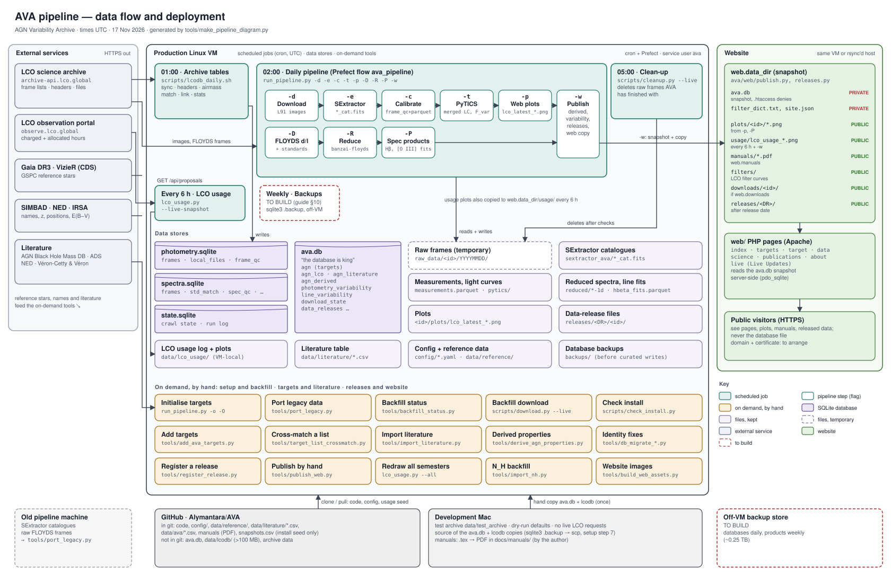

# AGN Variability Archive (AVA)

Reverberation mapping pipeline for LCO (Las Cumbres Observatory) data.
Handles FLOYDS spectroscopy and multi-band photometry for AGN monitoring campaigns.

## Pipeline overview

[](docs/figures/ava_pipeline_overview.svg)

External services, scheduled jobs, on-demand tools, data stores, what lives on the VM versus GitHub, and the
website. Click the image for the full-size version. An interactive copy, with a description of every box, is
in `docs/figures/ava_pipeline_overview.html` (open it locally). Regenerate both with
`python tools/make_pipeline_diagram.py`. Deployment details: [deployment guide](docs/guides/deployment_guide.md)
and [Linux set-up](docs/guides/linux_setup.md).

## Quick start

```bash
# 1. Clone and create environment
conda env create -f environment.yml
conda activate ava

# 2. Install in editable mode
pip install -e ".[dev]"

# 3. Configure
cp .env.example .env           # fill in LCO_API_TOKEN etc.
# Edit config/ava_config.yaml  # set paths, floyds_pipeline, etc.

# 4. Migrate existing database (first time only)
python -m ava.database.migrate --source /path/to/floyds/AVA/ava.sqlite

# 5. Run pipelines
ava-ingest     # download new LCO data
ava-spec       # reduce FLOYDS spectra
ava-phot       # reduce photometry / build light curves
ava-db         # update AGN database stats
```

## Project structure

```
ava/              Core Python package
  config.py       Configuration loader (reads config/ava_config.yaml)
  database/       SQLAlchemy models + migration from legacy DB
  spectroscopy/   FLOYDS wrapper and post-processing
  photometry/     LCO photometric pipeline
  lco/            LCO archive API client
  utils/          Shared I/O helpers
config/
  ava_config.yaml Global settings (paths, LCO API, pipeline params)
  targets.yaml    AGN target list
scripts/          Top-level CLI entry points
data/             Raw, reduced, and final products (not in git)
web/              Website
tests/
notebooks/
```

## FLOYDS pipeline

AVA wraps [banzai-floyds](https://github.com/LCOGT/banzai-floyds) with
improvements developed for RM campaigns (see `/path/to/floyds/NOTES.md`).
Point `paths.floyds_pipeline` in `ava_config.yaml` to your banzai-floyds folder.

## Database

SQLite by default (`data/ava.db`). Its `agn` catalogue has 71 entries, of which 65 are
AVA AGN targets with LCO photometry and/or FLOYDS spectroscopy (the ones the website shows
and counts; see `AVA_EXCLUDED` / `AVA_NON_AGN_TYPES` in `web/includes/config.php`).
