# PyTICS in the AVA pipeline: integration report

*Mrk 817 test archive · overnight 15–16 Nov 2026, per-camera colour terms added 16 Nov · figures in `docs/figures/pytics/`*

## Summary

- **Integrated.** PyTICS (Vieliute et al. 2025, Astroberta/PyTICS) now runs inside the pipeline as `ava/photometry/ensemble.py`. It is a vectorised port of `Filter.Corr`.
  - On real data it gives **bit-identical results** to the published code: AGN differences < 1e-10 mmag over 2,858 epochs.
  - It is **40–70× faster**: g band, all data, 7.2 min → 6.1 s.
- **Two modes, as requested.**
  1. **Full, on demand.** The whole Mrk 817 data set recalibrates in **24 s**: 8 filters, 19.5k QC-pass frames, 1.4 M star measurements. It took 53 s before the stopping rule in §3.
  2. **Incremental.** New frames are fitted against the stored solution in **16–40 ms per filter per night**. They agree with a full refit to **0.05–0.6 mmag rms** (u: 6 mmag right after a new camera appears, which triggers an automatic refit).
- **Absolute calibration.** The PyTICS star means are tied to Gaia GSPC with a fitted colour term per filter, evaluated at the AGN colour.
  - Zero-point errors are **±2 mmag** in B g V r i, ±6 in z and ±9 in u.
  - The colour terms are significant: g +0.044, i +0.027, B −0.032 and z −0.035 mag per mag of g−i.
- **Per-camera colour terms (added 16 Nov, §6b).** Each telescope+camera now gets its own colour slope, used in u, B, g and V.
  - AGN offsets between Sinistro cameras drop 30–45 % in B, g and V.
  - Same-night agreement between two Sinistro cameras improves by 8–12 % in u, g and V.
  - r, i and z have nothing to gain (their slopes are ≲ 2 mmag per mag), so the terms are off there.
- **MuSCAT additive problem.** The flux-flux fit against Sinistro on matched nights gives a slope **a ≈ 1** and an additive offset **b = −0.47 (g), −0.81 (r), −0.98 (i), −1.04 (z) mJy**. That is −6.4 to −9.8 % of the flux, at 41–99σ.
  - This is host light outside MuSCAT's 8.9″ aperture. A pure Δmag cannot fix it (it would rescale the variability).
  - It is now corrected; the merged light curves are continuous through 2021–22.
- **AGN repeatability improves** over the per-frame-ZP light curve, measured as frame-to-frame scatter within 1 h:

  | Band | Per-frame ZP (mmag) | PyTICS (mmag) |
  |---|---|---|
  | u | 7.7 | 3.3 |
  | g | 3.9 | 2.8 |
  | r | 3.3 | 2.5 |
  | i | 4.1 | 3.0 |
  | z | 4.8 | 3.5 |
  | B, V | same within 0.2 | same within 0.2 |

## 1. What was built

| Piece | Where | What it does |
|---|---|---|
| Ensemble solver | `ava/photometry/ensemble.py` | `fit` (full PyTICS), `update` (new epochs), `apply` (AGN), `absolute_zp`, `agn_zero_points`, `run_target` |
| Stored solution | `<phot>/pytics/<filter>/` | `stars`, `scopes`, `epochs` and `star_scope` Parquet files, plus `meta.json` (includes ZP and colour-term fit) |
| Intercalibration | `ava/photometry/intercal.py` | flux-flux fit F_scope = a·F_ref + b per camera; `apply_intercal` |
| Prefect task | `ava/pipeline/tasks/ensemble.py` | runs the above, writes `agn_lightcurve_pytics.parquet/.csv` and the merged web plots `lco_latest_<obj>_merged[_last6]` |
| Flow and CLI | `flows.py`, `scripts/run_pipeline.py`, `scripts/deploy.py` | new stage `ensemble` (tags photometry, calibration, pytics); `-t` (incremental), `--pytics-full` |
| Config | `config/ava_config.yaml → ensemble:` | filters, mode, loops, damping, star selection, bad flags, absolute/colour term, cameras to correct |
| Tests | `tests/test_ensemble.py` (6 tests, offline) | recovers injected offsets and per-camera colour terms, update ≡ refit, flag cut, save/load, intercal |
| Validation scripts | `tools/pytics_validation/` | runs of the original, the comparisons, report figures |

Usage:

```bash
python scripts/run_pipeline.py --target Mrk_817 --pytics-full
```

```bash
python scripts/run_pipeline.py --target Mrk_817 -t
```

The first recalibrates everything (~40 s with Prefect start-up). The second is the daily run: new frames only, with an automatic refit when one is needed.

`agn_lightcurve_pytics.parquet` columns:

| Group | Columns |
|---|---|
| Identification | `frame`, `MJD`, `Filter`, `telid`, `camera`, `scope` |
| Absolute AB | `mag`, `mag_err` |
| Inputs and corrections | `mag_inst`, `magerr`, `DMAGT`, `DMAGS`, `CKterm` (per-camera colour term at the AGN colour), `rms_t`, `rms_sc`, `n_stars`, `zp_err` |
| Quality | `good` (rms_t < 50 mmag and ≥ 5 comparison stars) |
| Intercalibrated product | `F`, `Ferr` (mJy); `F_ic`, `Ferr_ic`, `mag_ic`, `mag_ic_err` |
| Correction applied | `ic_a`, `ic_b` |

## 2. Fidelity and speed

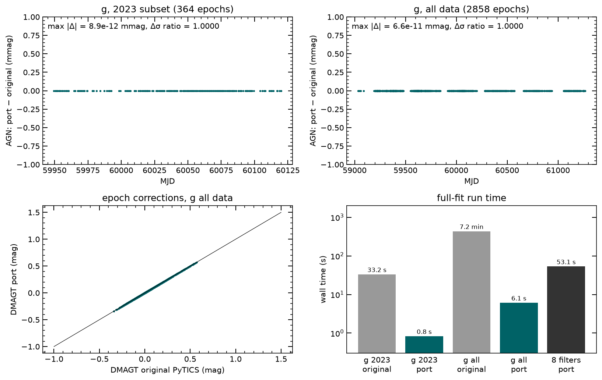

The port follows `Filter.Corr` step by step, using the same `arx` (avgrmsx) maths compiled once with numba.

- **Validation runs.** I ran the published PyTICS (commit 003bcbd) on two inputs:
  - a g-band 2023 subset: 47k rows, 364 epochs, 4 cameras;
  - the full g band: 295k rows, 2,858 epochs, 13 cameras.
- **Results.** Star means, rms★, DMAGT, DMAGS, rms_t, rms_sc and the AGN light curve agree to float precision. The original stops after the same number of loops: 38 for the subset; 67 for the full set, which was pre-cleaned to match the port's flag cut.
- **Speed.**
  - The original takes 33 s and 434 s; the port takes 0.8 s and 6.1 s.
  - The original's cost grows with the number of epochs × stars because of its pandas loops. The port's grows linearly with the number of rows.

**Deliberate differences from the published code** (all switchable):

1. **The AGN is never a comparison star.** `Corr` and `CorrUpdate_New` call `Brightest_Reduced` without `AGN_ID`. The AGN is always among the brightest, so the published code includes it unless it is passed in `bad_IDs`.
2. **Flagged comparison measurements are dropped** (SExtractor FLAGS 4 saturated, 8 truncated, 16 incomplete aperture; `bad_flags: 28`). This was needed for convergence; see §3. The AGN rows are never dropped.
3. **The stopping rule** (§3) floors the error of the extra-variance parameters at 1 mmag, and also stops once the solution is stationary. `rms_err_floor=0, atol=0` gives the exact PyTICS rule. That is how figure 1 was made: still identical to 7e-11 mmag.
4. **An optional colour term per camera** (§6b).

Other PyTICS issues noted (not used by the port, recorded for Roberta):

- `Phot_Cal` takes `mag_aper.values[0]` (one epoch) rather than the star mean.
- `CorrUpdate_New` has its merge commented out.
- There is no colour term in the zero point.

## 3. Full calibration of Mrk 817 (on demand)

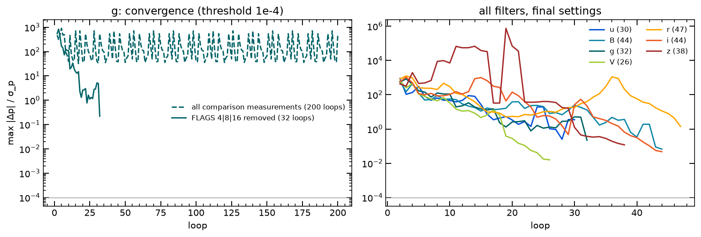

The first full run converged in V, r, i and z, but **u, B and g looped to the 200-iteration cap**.

- **Cause.** The parameter that would not settle was rms_t of a handful of MuSCAT epochs, which have only 12–13 comparison stars in the 9′ field. One star sat at the frame edge (FLAGS 8+16) and was 2.6 mag off. The extra-variance average (`arx`) then has two solutions: rms_t ≈ 0 with a biased DMAGT, or rms_t ≈ 0.6 mag. It flips between them, and DMAGT jumps by 0.1 mag.
- **Fix.** Dropping FLAGS 4|8|16 comparison rows (1.0 % of rows on Sinistro, 4.6 % on MuSCAT) makes every filter converge in 55–130 loops with the PyTICS rule (left panel above, dashed vs solid).

**A second, harmless non-convergence turned up with the colour terms (B band).**

- **What it was.** The light curve was fixed to < 3 µmag per loop, but the PyTICS test never passed, for two reasons:
  - An epoch whose rms_t sits at 0 has a quoted error of ~1e-9 and flips between 0 and 0.7 mmag.
  - A whole camera's DMAGT can trade against its own DMAGS (+0.75 / −0.63 mmag) without changing any prediction, a gauge freedom of the model.
- **The fix** (`fit(rms_err_floor=1e-3, atol=1e-5)`):
  - the stopping test floors the error of the extra-variance parameters at 1 mmag;
  - the fit also stops once the gauge-free solution (per-epoch DMAGT + DMAGS and the star means, each up to a common shift, plus the colour terms) moves by < 10 µmag for 3 loops.
- **Effect.** Every filter now stops in 26–47 loops (`meta.stop = 'stationary'`). The AGN light curve changes by ≤ 0.02 mmag versus running to the PyTICS rule.

| Filter | Comparison stars | Cameras | Epochs | Rows | Loops (PyTICS rule) | Loops (final) | Fit time, final (s) | Flagged epochs (rms_t > 50 mmag) |
|---|---|---|---|---|---|---|---|---|
| u | 70 | 11 | 1,716 | 103k | 55 | 29 | 2.4 | 65 (3.8 %) |
| B | 99 | 11 | 2,165 | 188k | 66 | 26 | 3.6 | 52 (2.4 %) |
| g | 100 | 13 | 2,858 | 221k | 67 | 37 | 3.6 | 33 (1.2 %) |
| V | 100 | 12 | 2,355 | 227k | 130 | 26 | 2.6 | 43 (1.8 %) |
| r | 100 | 13 | 2,924 | 231k | 93 | 47 | 4.3 | 49 (1.7 %) |
| i | 100 | 13 | 2,791 | 218k | 70 | 44 | 3.0 | 34 (1.2 %) |
| z | 100 | 13 | 2,664 | 205k | 76 | 38 | 2.3 | 44 (1.7 %) |
| Y | 99 | 2 | 10 | 1k | 49 | 26 | 0.01 | 0 |

The PyTICS-rule column is the flag cut without colour terms. The final column is the current settings: stationary rule, plus colour terms in u, B, g and V. A full run takes 24 s of compute, plus about 15 s of Prefect start-up and I/O; the peak memory is 0.8 GB.

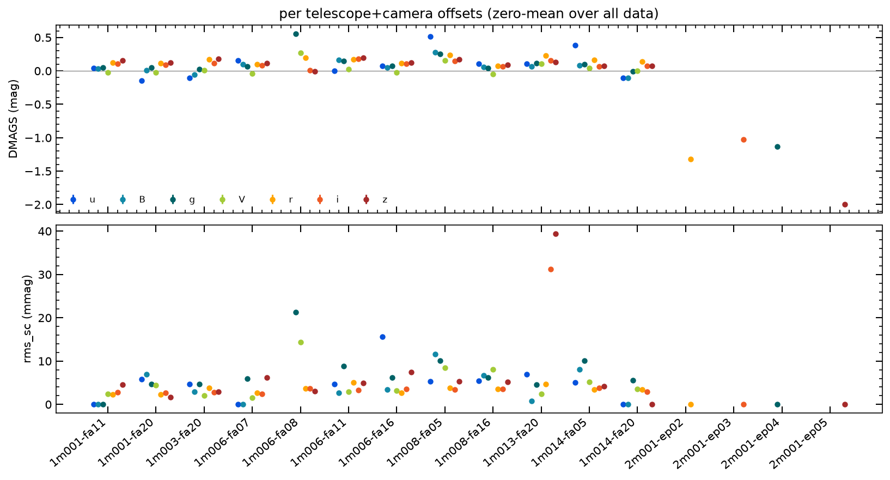

**Per-camera offsets (DMAGS).**

- The Sinistro cameras sit within ±0.2 mag of each other (aperture-loss and throughput differences). MuSCAT is −1.0 to −2.0 mag (2 m mirror).
- The extra camera scatter rms_sc is 0–10 mmag.
- **1m006-fa08 stands out:** DMAGS +0.5 mag and rms_sc 25 mmag in g, 16 mmag in V. In the per-frame calibration its u and B frames fail QC entirely. This camera is worth a look.
- 1m013-fa20 has a large rms_sc in i/z, but only 8 frames.

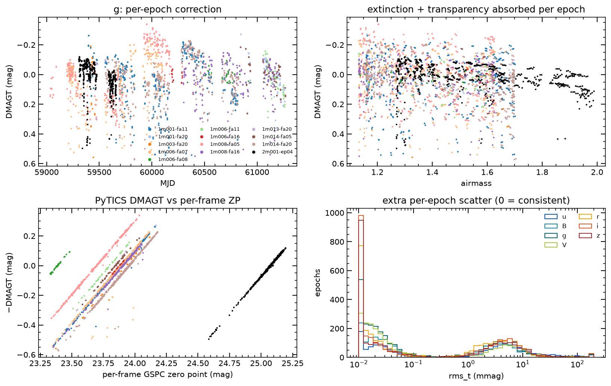

**Per-epoch corrections (DMAGT)** follow the per-frame GSPC zero point one-to-one within each camera (bottom left). The ensemble and the reference-star zero point see the same transparency.

rms_t is bimodal: about half of the epochs are fully consistent (rms_t ≈ 0), and the rest carry 1–10 mmag of extra scatter. The 1–4 % of epochs above 50 mmag are flagged `good = False` and kept out of the products and plots.

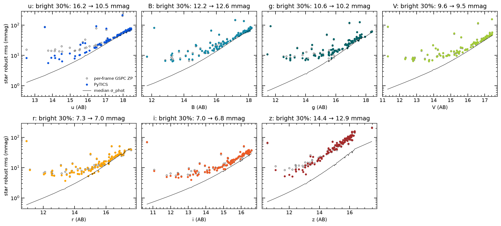

**Comparison-star repeatability.**

- For the brightest 30 % of stars it is essentially the same with PyTICS and with per-frame ZPs in B–i: 7–12 mmag.
- It is better in u (16 → 10 mmag) and z (14 → 13 mmag).
- The floor (~5–10 mmag above σ_phot) is set by star × camera differences across 13 cameras. The per-camera colour terms (§6b) remove only a small part of it (B 12.6 → 12.3 mmag), so most of it is not colour-related.

## 4. Incremental update (daily mode)

What the update keeps from the stored solution:

- the star means and rms★;
- the camera offsets DMAGS and rms_sc;
- the **star × camera offsets** (the per-camera star means that PyTICS' first step uses).

Each new epoch gets DMAGT and rms_t from a single `arx` over its comparison stars. A camera not seen before gets its DMAGS from its own first epochs.

Storing the star × camera offsets was essential. Without them, updated epochs had 3–5 mmag of spurious rms_t, and the agreement with a refit was 2–5× worse (g: 0.49 → 0.09 mmag).

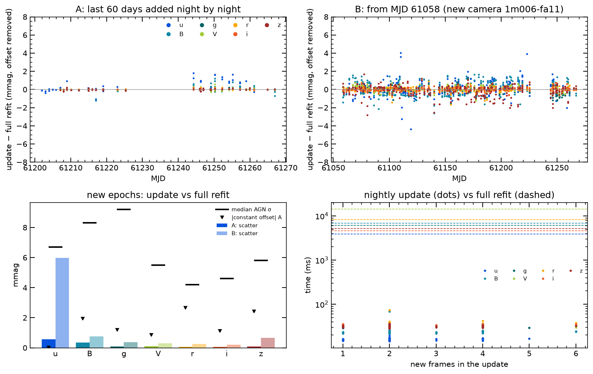

Two tests, adding data night by night and comparing with a full refit on everything:

| Filter | A: new epochs | A: scatter (mmag) | A: constant offset (mmag) | B: scatter (mmag) | Update time per night (ms) | Full refit (s) | AGN σ (mmag) |
|---|---|---|---|---|---|---|---|
| u | 63 | 0.57 | 0.0 | 5.98 | 17 | 4.4 | 6.7 |
| B | 62 | 0.34 | −1.9 | 0.77 | 25 | 8.0 | 8.3 |
| g | 63 | 0.09 | −1.2 | 0.37 | 33 | 7.1 | 9.2 |
| V | 62 | 0.12 | −0.9 | 0.29 | 33 | 16.0 | 5.5 |
| r | 64 | 0.06 | −2.7 | 0.26 | 36 | 9.4 | 4.2 |
| i | 60 | 0.05 | −1.1 | 0.21 | 35 | 5.2 | 4.6 |
| z | 56 | 0.09 | −2.4 | 0.67 | 33 | 5.5 | 5.8 |

- **Test A:** the last 60 days are added.
- **Test B:** everything from MJD 61058 is added (120–130 nights per filter), which includes a new camera, 1m006-fa11.

How to read the results:

- **The update reproduces the refit far below the photometric errors.** The only systematic difference is a constant of 0–3 mmag (up to 8 in test B).
- **That constant applies to the whole history, not just the new points.** The old epochs shift by the same amount, to ≤ 0.3 mmag (`hist_off_mmag` vs `new_off_mmag` in `incremental_summary.csv`). A refit redefines the zero-mean of DMAGS; with the absolute ZP refitted at the same time, it cancels.
- **The u band with a new camera** (6 mmag) is the one case where an update is not good enough.
- **The refit rule.** `update` returns `needs_refit` when:
  - a new camera has appeared;
  - more than 10 % of epochs come from updates;
  - the median rms_t of updated epochs exceeds 2× that of the full fit + 2 mmag.

  `run_target(auto_refit=True)`, the default, then refits immediately, which costs only seconds.
- **With per-camera colour terms on** (u, B, g, V), test A agrees with a refit to 0.3–1.0 mmag (u 1.0, B 0.5, g 0.4, V 0.3), still far below the errors. A camera that appears after the last refit has no colour term yet; it is already flagged and refitted automatically.
- **The daily run via Prefect** takes ~15 s in all. Most of that is reading Parquet and drawing the plots; the update arithmetic for 8 filters is 0.27 s.

## 5. Absolute zero point

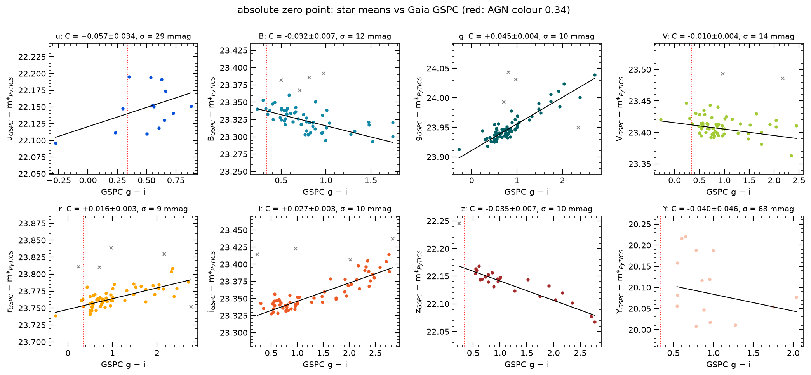

The fit is `m_GSPC − m*_PyTICS = ZP + C·[(g−i) − c0]` over the comparison stars:

- **Inputs:** stars with GSPC `quality_ok`, rms★ < 50 mmag, the AGN excluded.
- **Weights:** 1/(σ_m*² + σ_ref² + rms★² + 0.01²).
- **Clipping:** iterated at 3σ (MAD-based).

| Filter | Stars used | ZP | C (per mag g−i) | Star scatter (mmag) | Scatter without colour term (mmag) | ZP at AGN colour |
|---|---|---|---|---|---|---|
| u | 14 | 22.152 ± 0.009 | +0.057 ± 0.034 | 29 | 31 | 22.140 |
| B | 57 | 23.325 ± 0.002 | −0.032 ± 0.007 | 12 | 16 | 23.337 |
| g | 63 | 23.946 ± 0.002 | +0.045 ± 0.004 | 10 | 14 | 23.926 |
| V | 61 | 23.408 ± 0.002 | −0.010 ± 0.004 | 14 | 15 | 23.412 |
| r | 62 | 23.761 ± 0.002 | +0.016 ± 0.003 | 9 | 12 | 23.754 |
| i | 63 | 23.346 ± 0.002 | +0.027 ± 0.003 | 10 | 14 | 23.328 |
| z | 24 | 22.143 ± 0.006 | −0.035 ± 0.007 | 10 | 18 | 22.164 |
| Y | 15 | 20.09 ± 0.016 | −0.04 ± 0.05 | 68 | 72 | (unreliable) |

**How the colour term is applied.**

- It is evaluated at the AGN's own colour, g−i = 0.34, taken from its calibrated mean magnitudes (iterated). The median star has g−i ≈ 0.77.
- That AGN–star colour difference explains most of the **constant offsets between the PyTICS and per-frame light curves**. The per-frame calibration has no colour term.

  | Band | Colour-term prediction (mmag) | Measured offset (mmag) |
  |---|---|---|
  | g | −19 | −20 |
  | B | +14 | +18 |
  | z | +15 | +24 |
  | r | −7 | −15 |
  | i | −12 | −29 |
  | V | +4 | +6 |

- Only one mean AGN colour is used. The AGN is bluer when brighter, so a per-epoch colour would move the ZP by ≲ 4 mmag in g. This is listed as a future option.
- Because the colour term is applied, the per-frame `colour_slope` diagnostic is redundant for PyTICS products.

**Single-field limitation.** The colour terms here come from one field: about 60 stars spanning g−i = −0.3 to 2.8. The earlier plan was to share C_f across targets; running this on a few more fields will show whether C_f is universal per filter and per camera family.

## 6. MuSCAT additive offset and per-camera colour terms

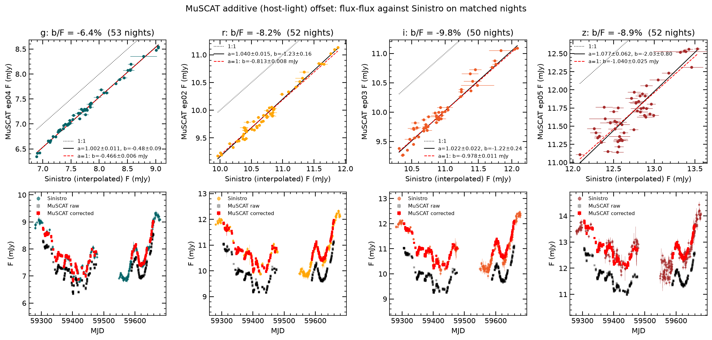

**Method.**

- Per filter and camera, the AGN's nightly-mean flux is compared with the Sinistro light curve. The reference is all `fa` cameras except the one tested, interpolated linearly when the gap is < 3 days.
- The fit is F = a·F_ref + b, with errors on both axes and 4σ clipping. A second fit fixes a ≡ 1, because the stars already set the flux scale.

| MuSCAT band | Nights | a | b (free a), mJy | b (a ≡ 1), mJy | b/F | Equivalent constant Δmag |
|---|---|---|---|---|---|---|
| g (ep04) | 53 | 1.002 ± 0.012 | −0.48 ± 0.09 | **−0.467 ± 0.006** | −6.4 % | 0.066 |
| r (ep02) | 52 | 1.040 ± 0.015 | −1.23 ± 0.16 | **−0.813 ± 0.008** | −8.2 % | 0.086 |
| i (ep03) | 50 | 1.022 ± 0.022 | −1.22 ± 0.24 | **−0.978 ± 0.011** | −9.8 % | 0.098 |
| z (ep05) | 52 | 1.08 ± 0.06 | −2.0 ± 0.8 | **−1.040 ± 0.025** | −8.9 % | 0.091 |

**What the fit shows.**

- **a is consistent with 1** (within 1–2.6σ) in every band. The relation is a pure additive offset, as expected for host light outside MuSCAT's 8.9″ aperture.
- **In g, the colour term moved a from 0.984 to 1.002 and b from −0.55 to −0.47 mJy.** MuSCAT g has the steepest colour response of any camera (−39 mmag per mag), so part of the old g offset was colour, not host.
- **b grows towards the red** (0.47 → 1.04 mJy), consistent with a red host galaxy. These numbers match the 0.07–0.08 mag nightly offsets found earlier from the per-frame light curves.
- **The correction applied** is F′ = F − b with a ≡ 1. The free-a fit is degenerate with b over MuSCAT's limited flux range, and in z its uncertainty is large.
- **Which cameras are corrected** is set by `ensemble.intercal_correct_cameras: ["ep"]`. All cameras are still fitted and reported in `pytics/intercal.csv`.
- **After the MuSCAT 39 px re-extraction**, re-running intercal should show b shrink to near 0. That will be the check that the aperture was the cause.

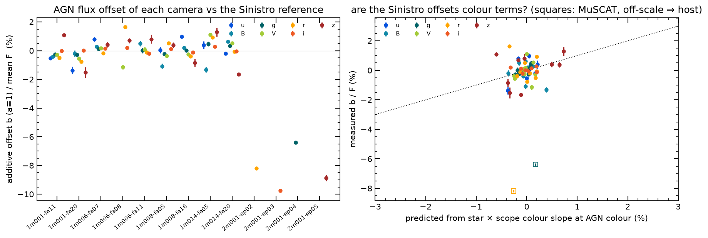

**The Sinistro cameras also differ from each other, at a smaller level:** typically ±0.5–2 %, 0.8 % rms across the camera × filter pairs. These offsets are statistically significant.

- The right-hand panel compares them with the AGN offset predicted from each camera's **star × camera colour slope** (figure 9), evaluated at the AGN colour.
- The two correlate (Pearson r = 0.50) with roughly the right amplitude. So a good part of the inter-Sinistro offset is a per-camera colour term: the AGN is bluer than the comparison stars, so a camera with a different colour response sees it at a different relative brightness.
- MuSCAT is far off this relation (squares), confirming that its offset is host light.

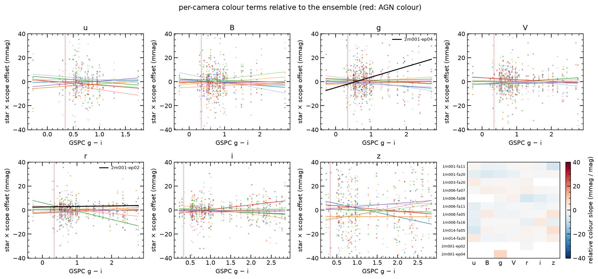

Per-camera colour slopes relative to the ensemble are typically ±10–20 mmag per mag of g−i in B and g. They reach −40 for 1m006-fa08 in g, and are small in r and i.

**These numbers motivated the per-camera colour term (§6b).** Figures 9 and 11 above show the state *after* it: in u, B, g and V the star × camera offsets no longer contain the colour slope. As a result, the predicted-vs-measured correlation has dropped from 0.50 to 0.16, and the overall Sinistro offset rms from 0.81 % to 0.68 %.

### 6b. Per-camera colour terms (implemented and tested)

The model gains one term per telescope+camera:

    m_obs = m*_s + DMAGT_t + DMAGS_k + CK_k · [(g−i)_s − c0]

How it is fitted:

- **Star colours:** GSPC g−i from `reference_stars.csv`. Stars without a colour get no term.
- **When:** inside every PyTICS loop, after the DMAGS step, as a weighted slope with a free intercept, damped by `safe` like DMAGT and m★.
- **Constraint:** CK is zero-mean over the data, because a slope common to all cameras is absorbed by the star means and then by the absolute colour term C (§5).
- **Applying it:** the AGN gets `CK_k·(c_AGN − c0)` at its mean colour (g−i = 0.34).
- **Updates:** new epochs subtract the stored CK. A new camera has CK = 0 until the next refit, which is triggered automatically.

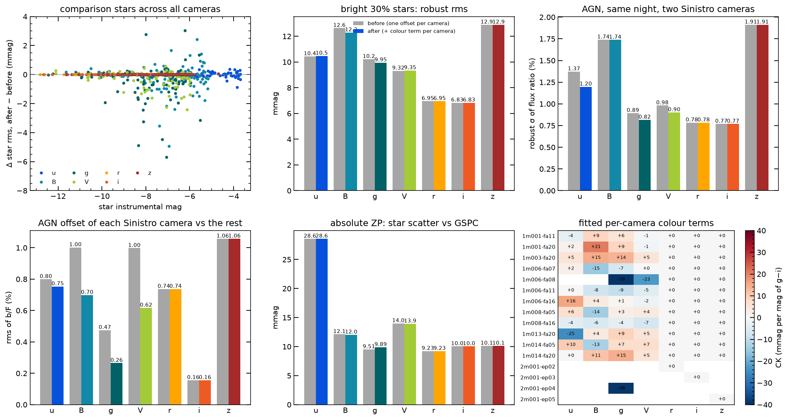

Before vs after, same frames (`tools/pytics_validation/compare_colour_terms.py`; numbers in `pytics_colour_terms_effect.csv`):

| Filter | Fitted CK range (mmag/mag) | Sinistro AGN offsets, rms of b/F (%) | AGN same-night, two Sinistro cameras, robust σ (%) | Bright-star rms (mmag) | ZP star scatter (mmag) |
|---|---|---|---|---|---|
| u | −25 … +16 | 0.80 → **0.75** | 1.37 → **1.20** | 10.4 → 10.5 | 28.6 → 28.6 |
| B | −15 … +21 | 1.00 → **0.70** | 1.74 → 1.74 | 12.6 → **12.3** | 12.1 → 12.0 |
| g | −39 … +15 | 0.47 → **0.26** | 0.89 → **0.82** | 10.2 → **10.0** | 9.5 → 9.9 |
| V | −23 … +7 | 1.00 → **0.62** | 0.98 → **0.90** | 9.3 → 9.4 | 14.0 → 13.9 |
| r | −7 … +3 (not used) | 0.74 → 0.83 if used | 0.78 → 0.82 if used | — | — |
| i | −4 … +4 (not used) | 0.16 → 0.24 if used | 0.77 → 0.69 if used | — | — |
| z | −4 … +14 (not used) | 1.06 → 1.12 if used | 1.91 → 1.94 if used | — | — |

**Verdict.**

- **It improves the blue bands.** The camera-to-camera AGN offsets, the quantity the term is designed for, drop by 30–45 % in B, g and V and by 6 % in u. The direct same-night test (two Sinistro cameras on the same night, no interpolation) improves by 8–12 % in u, g and V.
- **B is the exception on the same-night test:** it is unchanged at 1.74 %. It is noisier, and its residual offsets are not colour-like.
- **In r, i and z the slopes are tiny**, and using them changes things only at the noise level (slightly worse in r and z). The pipeline now **decides this per target and filter** (`scope_colour_terms: auto`, `colour_term_check`). It fits with and without the terms and keeps them only if the AGN agrees better between Sinistro cameras by ≥ 5 %. For Mrk 817 this reproduces the choice here: on for u, B, g and V, off for r, i, z and Y. Other AGN may differ. See `docs/pytics_algorithm_changes.md` §2.2.
- **The camera-to-camera offsets do not go away entirely** (0.3–0.75 % remain). Their remaining causes are not colour; plausibly host light varying with seeing, since the 10.5″ aperture holds a different host fraction in different seeing. That is a separate correction (seeing-dependent host term), not attempted.
- **Absolute ZP and repeatability are unchanged.** The AGN light curves shift by 0–1.5 mmag on average.
- **Wider differences from the per-frame light curve are expected.** In g and B the time-dependent PyTICS − per-frame difference grows (g 4.4 → 5.7 mmag rms), because the per-frame calibration has no camera colour terms. It is not a loss of quality.

**Not applied:** additive corrections to Sinistro. The colour part is now handled by CK, and the rest is not an aperture effect.

## 7. AGN light curves: PyTICS vs per-frame calibration

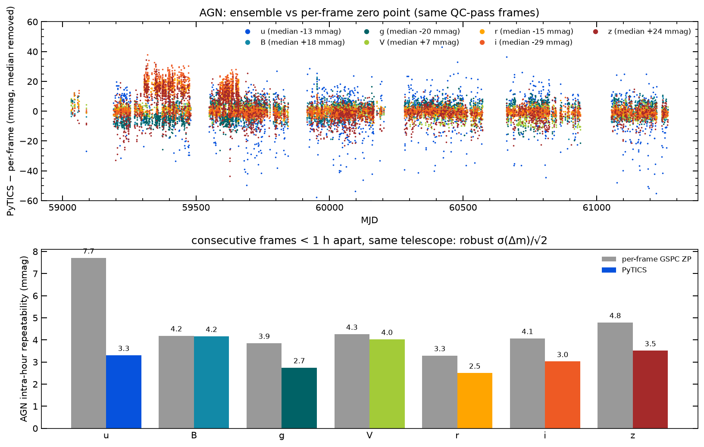

The comparison uses the same QC-pass frames.

- **Constant offsets** of −29 to +24 mmag between the two light curves are explained mostly by the colour term (§5).
- **Time-dependent differences** have a robust rms of 2–4 mmag in B–i, 9 mmag in z and 12 mmag in u. In u, the per-frame calibration has only a handful of standards per frame.
- **The 2021–22 bumps** (+15–20 mmag in i and z) are the MuSCAT frames, before the additive correction. PyTICS and the per-frame calibration put MuSCAT at different levels because PyTICS' DMAGS for MuSCAT is set by all the stars, with their colours.
- **Intra-hour repeatability** (bottom panel) is the cleanest test of the per-epoch calibration noise, and PyTICS wins by 25–55 % in u, g, r, i and z.

## 8. Merged light curves

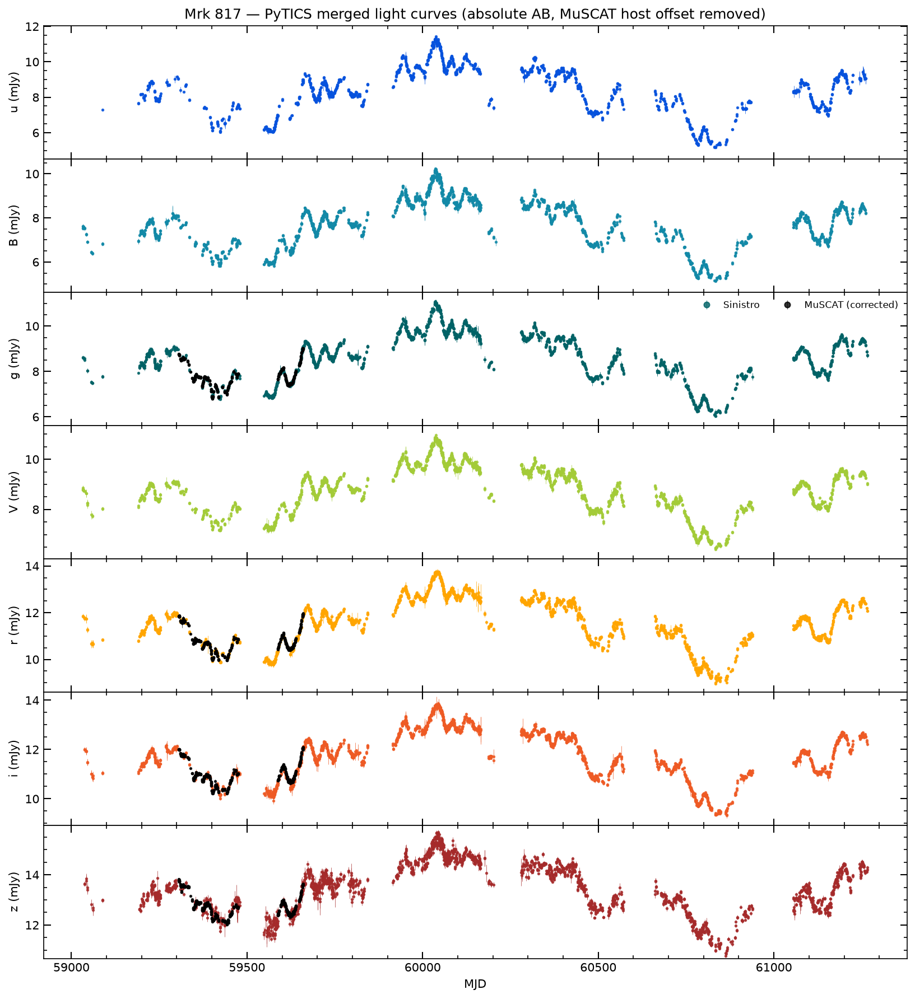

This is the final product: absolute AB fluxes in mJy, all 13 cameras merged, the MuSCAT host offset removed (black points), and flagged epochs removed.

The pipeline task writes the website versions to the target's figure folder `<phot>/<target>/plots/` (`cfg.target_plots_dir`): `lco_latest_<obj>_merged` and `_merged_last6`. They use the `filter_dict` colours and the legacy layout.

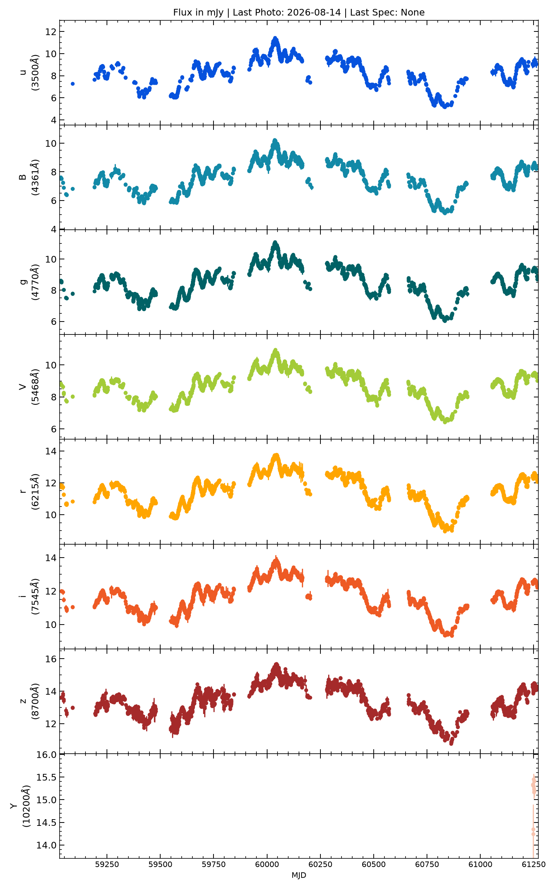
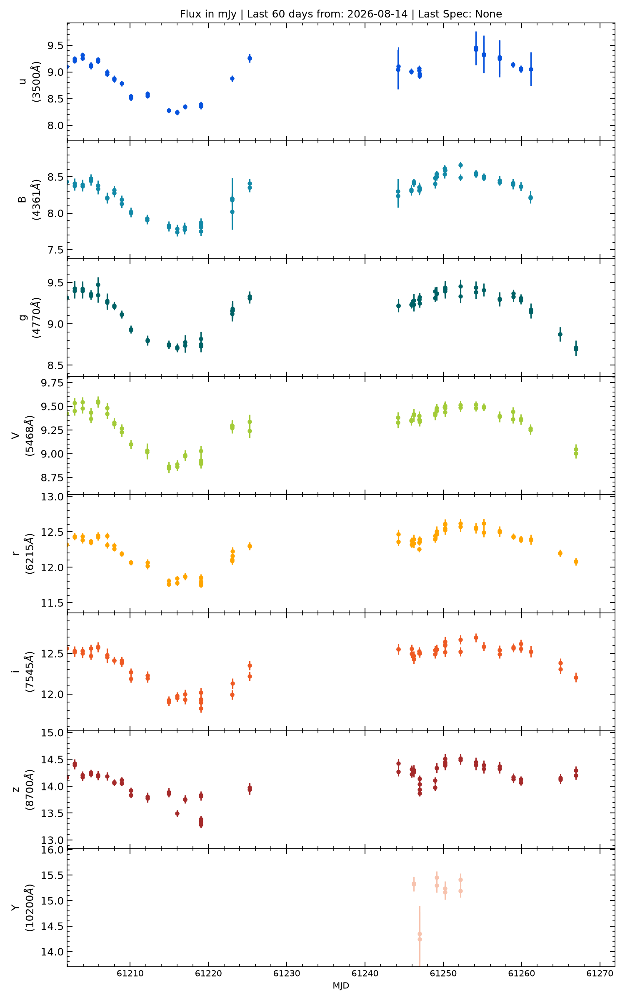

## 9. Quality, errors and the shareable product (added 16 Nov)

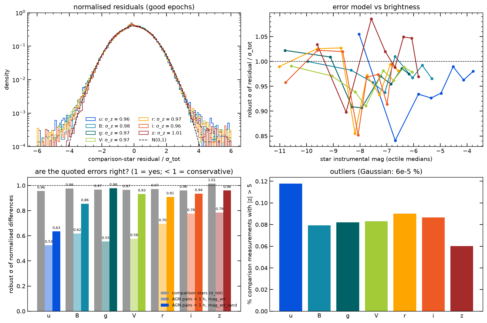
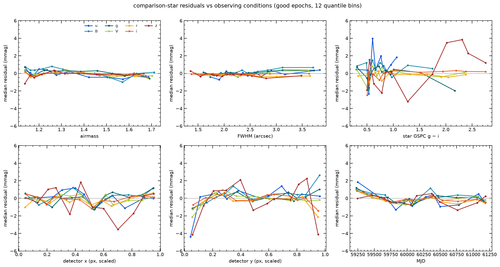
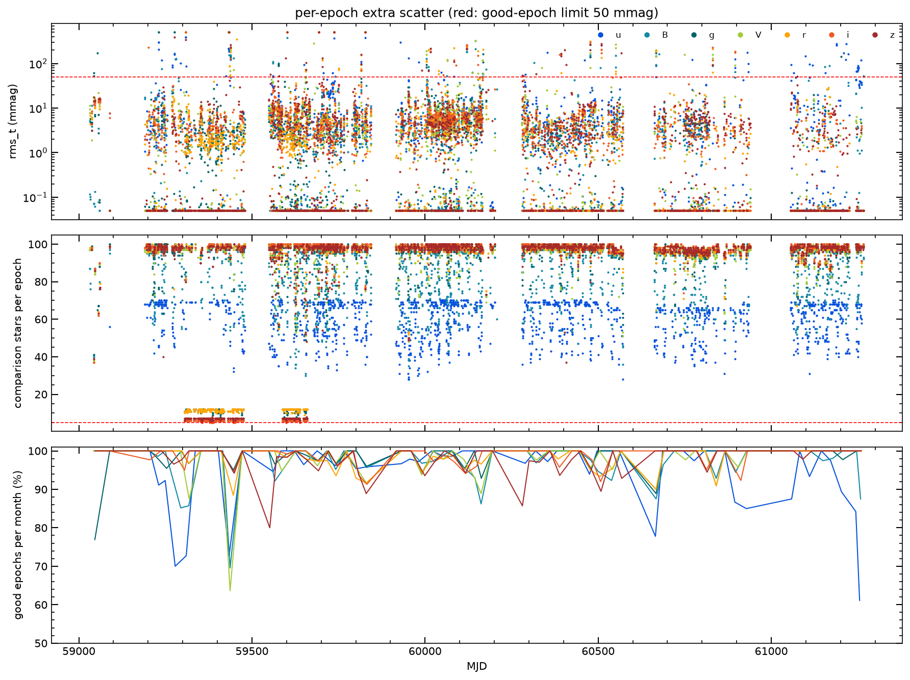

- **Comparison-star errors are right:** residual/σ has σ = 0.96–1.01 in every filter, at all brightnesses.
- **The PyTICS AGN error (`mag_err`) is conservative for epoch-to-epoch work.** AGN pairs < 1 h apart scatter only 0.53–0.79 σ, because it includes rms_sc, a per-camera systematic. The new `mag_err_rand` = σ_phot ⊕ rms_t gives 0.86–0.98 (u 0.63).
- **Residual trends:**
  - airmass and seeing: ≤ 1 mmag;
  - time: ±1 mmag;
  - detector y edges: up to −4 mmag in u and z;
  - star colour in z: ±4 mmag.
- **Good epochs:** 96–99 %. MuSCAT epochs have only 6–12 comparison stars.
- **The pipeline writes the merged light curves the same way as this report.** `lco_latest_<obj>_merged[_last6]` from the `ensemble` stage is pixel-identical to figures 13/14 except the title's "Last Spec" date.
- **Shareable file:** `<phot>/<target>_LCO_merged_lightcurve.csv`, also copied to the plots directory.
  - Columns: target, MJD, filter, telescope, camera, flux_mJy, flux_err_mJy, flux_err_random_mJy, mag_AB, mag_AB_err, mag_AB_err_random, frame.
  - Good epochs only, intercalibrated: 17,162 rows for Mrk 817.
- **All PyTICS and AVA parameters are in `config/ava_config.yaml → ensemble:`.**
- **Algorithm and changes documented** in `docs/pytics_algorithm_changes.md`, with the workflow diagram in `docs/figures/pytics/pytics_workflow.pdf` (TikZ source alongside).

## 10. Things to check or decide

1. **Per-camera colour terms are done** (§6b): on for u, B, g and V. Next accuracy step: what remains between Sinistro cameras (0.3–0.75 %) looks seeing-dependent (host light). A seeing term per camera could be tested the same way.
2. **Refit policy:** automatic on flags (current), or also a scheduled weekly full refit? Either costs well under 1 min per target.
3. **1m006-fa08:** strong outlier in DMAGS and rms_sc, and the per-frame QC rejects all its u and B frames.
4. **CALI `merge` stage:** with PyTICS plus the flux-flux intercal, CALI may be redundant for LCO photometry. It stays a stub until you decide.
5. **The Y band** has 10 frames and a 68 mmag ZP scatter. Treat it as unreliable for now.
6. **The base Python env cannot write Parquet.** `/opt/anaconda3` has a pyarrow 11 / pandas 2.2.1 binary mismatch: `conda list` shows pandas 1.5.3 and pyarrow 12 from pip, but Python imports pandas 2.2.1 and pyarrow 11. Everything here ran in a clean venv (pandas 3.1, pyarrow 26, numba 0.68). The pipeline needs a clean env from `environment.yml`; I added `numba` to `environment.yml` and `pyproject.toml`.
7. **Not done:** nothing was run on the production machine; no LCO requests were made (none were needed).

All of this is also in `docs/future_improvements.md` (new "PyTICS ensemble" section) for the documentation agent.
