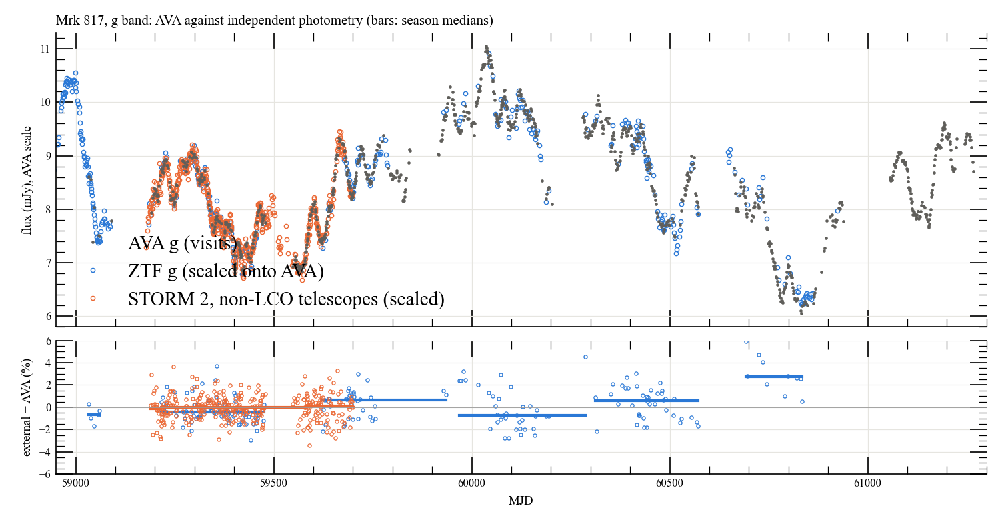
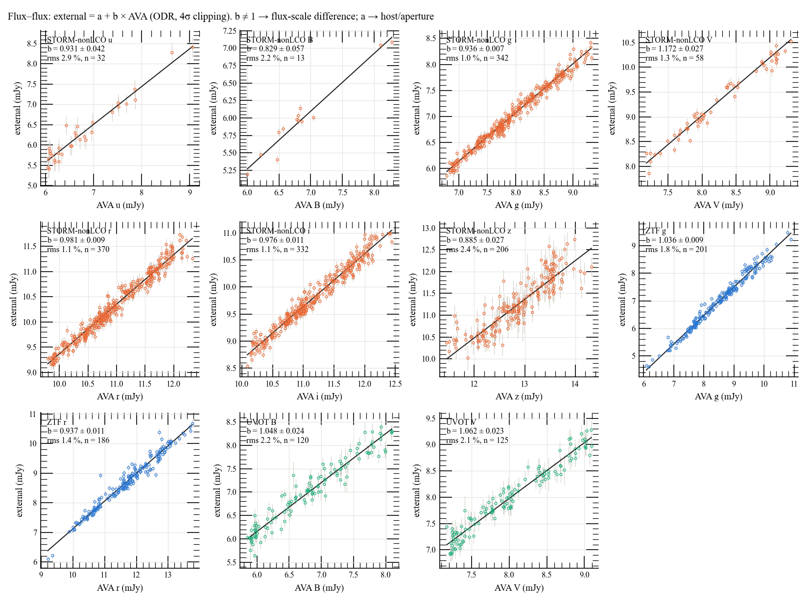
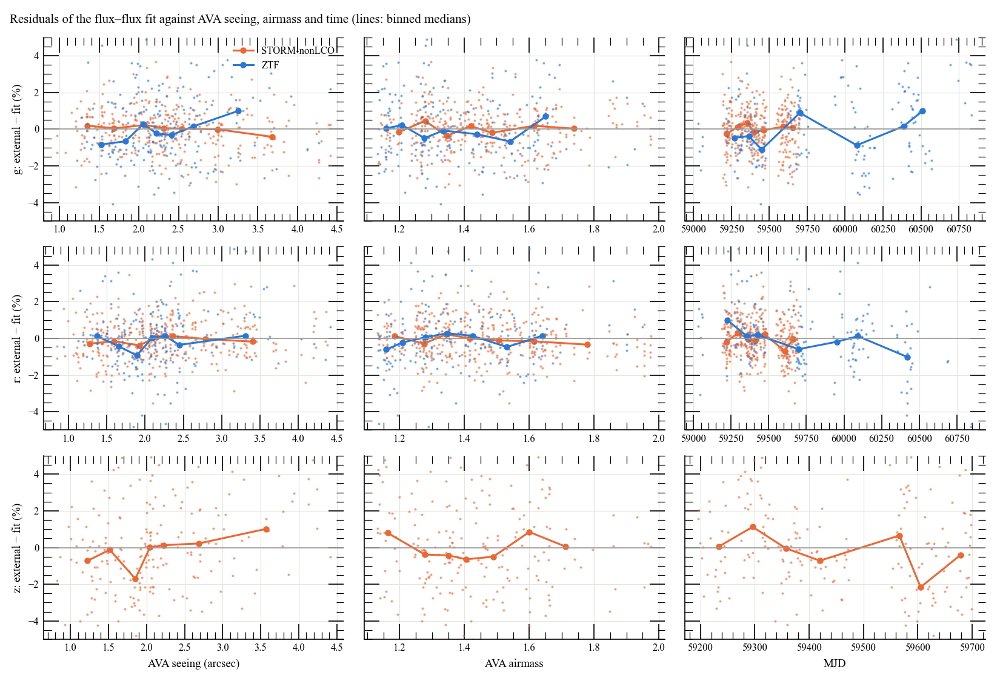

# Mrk 817: AVA photometry against independent data

**Question.** How well does AVA's Mrk 817 light curve agree with photometry that AVA did not make? This covers
relative accuracy (shape, scatter against the error bars, camera offsets, trends, timing) and absolute accuracy
(flux scale).

**Short answer.**

- **Relative: good.**
  - Against the independent telescopes of AGN STORM 2, the scatter is about 1 % in g, r and i, and the
    reduced χ² is 0.9–1.3 with AVA's total error bars.
  - Two independent reductions of the *same* LCO frames agree to 0.44–0.48 % rms in g, r and i.
  - Timing agrees to within ±0.5 d, with no systematic offset.
  - There are no trends above about 1 % with seeing or airmass.
- **One real AVA defect: Sinistro camera offsets of the AGN in r and z.** They reach 1–2 % (z, Teide:
  fa11 +1.3 %, 1m014-fa20 −1.9 %; r: ±0.5 %; r, fa08: +2.4 %).
  - AVA already measures them in `pytics/intercal.csv` but, by design, does not apply them to Sinistro.
  - Applying AVA's own numbers removes them: χ² falls from 55 to 8 (r, 9 camera tests) and from 28 to 2
    (z, 4 tests).
- **Absolute: within 3–7 %, and mostly explained.**
  - ZTF says the variable flux in AVA g is too faint by 32 ± 9 mmag. The calibration study predicts
    31 ± 11 mmag from emission lines and the AGN continuum.
  - In r, AVA is too bright by 44 ± 13 mmag (a 4 % flux-scale difference). The sign matches the Hα effect.
  - Swift/UVOT, through the same 5″ aperture, agrees with AVA's total B flux to 3 % and V to 0.4 %.
  - ZTF i suggests AVA's i variable flux is too bright by 96 ± 30 mmag, but ZTF i is poor here (χ²_ν 2.8,
    seeing trend). Treat it as indicative only.
  - Two AVA absolute products disagree with each other by up to 31 mmag (section 6).

## 1. AVA products used

All from the Mac test archive, `data/test_archive/photometry/Mrk_817/` (`paths.archive_root` in
`data/test_archive/ava_config.yaml`).

| product | file | made | notes |
|---|---|---|---|
| PyTICS light curve | `agn_lightcurve_pytics.csv` (+ `pytics/<band>/meta.json`) | 18 Nov 2026 16:57 | 100 stars, 13 scopes, converged in 37 loops (g). Colour terms kept in g only (the colour check rejected them in r, i, z). `error_model: fitted`. Absolute ZP from all GSPC stars at the AGN colour (lco_g − lco_i = 0.341). AGN intercalibration applied to MuSCAT only (`intercal_correct_cameras: [ep, kb, fs]`). |
| merged light curve (the product) | `Mrk_817_LCO_merged_lightcurve.csv` | 18 Nov 2026 16:57 | 17,162 epochs, u B g V r i z (+10 Y). It has no `#` header, so it was written before commit 5f45417 (19 Nov). The magnitudes and errors are identical to the DR1 release file (`releases/DR1/Mrk_817/photometry/`, 16 Nov 13:27) and to `web/data/releases/DR1/`; only the formatting differs. |
| per-frame absolute light curve | `agn_lightcurve.csv` | 15 Nov 2026 23:18 | per-frame ZP against GSPC stars, `qc_pass` flags. Used only for the internal check in section 6. |

The legacy pipeline's Mrk 817 output (`lco_latest*.pkl`) is not in the repo or the test archive. It was not
used.

AVA science aperture: 5.25″ radius (`photometry.science_aperture_radius_arcsec`). For this comparison, AVA
epochs were averaged into visits: frames less than 0.3 d apart, weighted by the random error. The visit error
is the random error of the mean ⊕ the camera term (σ_tot² − σ_rand²). The 0.3 d window is taken across all
cameras; for the per-camera test, within one camera.

## 2. Independent data: candidates and choice

| candidate | overlap with AVA | how independent | used |
|---|---|---|---|
| **ZTF DR light curves** (IRSA, field 822, `catflags = 0`), g 2018–2025, r 2018–2025 | 2020–2025, 201 (g) and 186 (r) matched nights | fully: other telescope, camera, pipeline, PSF photometry, PS1 calibration | **yes, primary for absolute** |
| **AGN STORM 2 XII** (Montano et al. 2026, ApJ 1003, 147; IOP machine-readable table), u B g V r i z, Dec 2020 – Apr 2022 | 1,100+ nights | Own pipeline: 5″ aperture, 5 comparison stars, APASS, PyCALI. **Non-LCO telescopes** (Zowada, Wise, Liverpool, WMO, CAHA, Lijiang, Asiago) are fully independent. **LCO telescopes** use the *same raw frames* as AVA and test only the reduction. | **yes, primary for relative** (split into those two subsets) |
| **Swift/UVOT B, V** (AGN STORM 2 IV, Cackett et al. 2023, ApJ 958, 195; IOP table) | Dec 2020 – Feb 2022, 120 (B) and 125 (V) matched | fully: space telescope, 5″ aperture (as AVA's 5.25″), UVOT calibration | **yes**, the only absolute check of B and V |
| ZTF i (field 822, 2018–2024) | 77 matched nights | fully | yes, section 7 (low quality) |
| ASAS-SN, Gaia DR3 epochs | — | — | not used: 8–16″ apertures and 2–5 % errors at g ≈ 14 add nothing beyond ZTF |
| legacy pipeline output | — | same frames, older reduction | not available |

CDS/VizieR was down ("Page unavailable") on 20 Nov 2026, so the two STORM 2 tables came from the journal's
machine-readable files. STORM 2 HJD − 2400000 was converted to MJD with −0.5 d; the heliocentric correction
(< 0.006 d) was ignored. STORM 2 f_λ and UVOT f_λ were converted to mJy at the LCO pivot wavelengths
(u 3575, B 4387, g 4752, V 5366, r 6225, i 7503, z 8644 Å) and at the UVOT pivots (B 4392, V 5468 Å).

**STORM 2's absolute scale is APASS** (with Fukugita/Bessell zero points), which the calibration study found
off by 0.03–0.17 mag. So STORM 2 tests the relative accuracy only; its flux-scale slopes (b = 0.81–1.19) say
more about APASS than about AVA.

## 3. Method

- **Matching.** Each external point is matched to the nearest AVA visit. LCO frames in STORM 2 are matched to
  the same telescope within 0.2 d. Independent data are matched to any AVA visit within 0.5 d.
  - For the independent data, AGN variability over the time difference |Δt| is added to the error. It is the
    noise-free rms flux change at that lag, from AVA's own structure function.
- **Fit.** F_ext = a + b · F_AVA, an orthogonal-distance fit with errors on both axes and iterative 4σ
  clipping (≤ 4 points clipped per set).
  - a absorbs the host light and aperture differences.
  - b is the ratio of the flux scales for the *variable* (point-source) light. For PSF photometry (ZTF) or
    near-identical apertures (UVOT, STORM 2), b − 1 is a calibration difference: Δm_var = −2.5 log b.
- **Scatter.** The robust rms of the fractional residuals, and χ²_ν with the combined errors. Also χ²_ν with
  AVA's random error only (no camera term).
- **Trends.** Spearman correlation of the residuals with MJD, AVA seeing, AVA airmass and |Δt|; binned medians
  in figure 4.
- **Camera offsets.** Each external set is put on AVA's scale with its band-wide fit. Each AVA telescope +
  camera is then compared with it separately (figure 3).
- **Timing.** χ² of F_ext = a + b · F_AVA(t − τ), with AVA interpolated, for τ = −2…+2 d. Fixed sample: points
  with an AVA gap below 3 d at every τ.
- Scripts and intermediate tables are in the session scratchpad (`scripts/`, `out/`). They are not in the repo.

## 4. Results per band

### 4.1 Relative accuracy

| band | data | n | rms of residuals | median error ext / AVA | χ²_ν (AVA total) | χ²_ν (AVA random only) |
|---|---|---|---|---|---|---|
| u | STORM 2 LCO, same frames | 138 | 1.5 % | 1.7 / 0.4 % | 0.91 | 0.93 |
| u | STORM 2 non-LCO (Liverpool) | 32 | 2.5 % | 3.8 / 0.4 % | 0.57 | 0.57 |
| B | STORM 2 LCO, same frames | 215 | 1.1 % | 0.6 / 0.5 % | 1.49 | 1.97 |
| B | STORM 2 non-LCO (WMO) | 13 | 1.8 % | 1.0 / 0.4 % | 2.2 | 2.6 |
| B | UVOT | 120 | 2.2 % | 1.8 / 0.6 % | 1.23 | — |
| g | STORM 2 LCO, same frames | 340 | **0.48 %** | 0.6 / 0.6 % | 0.42 | 0.71 |
| g | STORM 2 non-LCO | 341 | **1.06 %** | 1.0 / 0.5 % | 0.92 | 1.13 |
| g | ZTF | 199 | 1.8 % | 1.4 / 0.6 % | 1.37 (ZTF alone 1.96) | — |
| V | STORM 2 LCO, same frames | 226 | 0.60 % | 0.4 / 0.6 % | 0.73 | 1.27 |
| V | STORM 2 non-LCO | 58 | 1.30 % | 1.1 / 0.6 % | 1.06 | 1.24 |
| V | UVOT | 125 | 2.1 % | 1.9 / 0.6 % | 0.75 | — |
| r | STORM 2 LCO, same frames | 321 | **0.44 %** | 0.5 / 0.3 % | 0.58 | 0.70 |
| r | STORM 2 non-LCO | 370 | **1.06 %** | 0.9 / 0.3 % | 1.00 | 1.07 |
| r | ZTF | 182 | 1.4 % | 1.1 / 0.4 % | 1.81 (ZTF alone 2.22) | — |
| i | STORM 2 LCO, same frames | 271 | **0.44 %** | 0.6 / 0.4 % | 0.64 | 0.69 |
| i | STORM 2 non-LCO | 332 | **1.11 %** | 0.8 / 0.3 % | 1.20 | 1.30 |
| z | STORM 2 LCO, same frames | 304 | 1.0 % | 1.3 / 0.6 % | 1.29 | 1.33 |
| z | STORM 2 non-LCO | 206 | 2.5 % | 2.0 / 0.6 % | 1.55 | 1.67 |

What this says:

- **The scatter is set by the external data.** Their errors are 2–5 × AVA's in every independent set. So
  these data cannot test AVA's error bars below about 0.3 %. The pair test of all AGN
  (`docs/reports/pytics_update/pair_test_all_agn.md`) remains the test of the error model.
- **Within that limit, AVA's total errors are about right.**
  - Per independent telescope, χ²_ν is 0.6–1.4 with AVA's total error (g, r, i: Liverpool, Wise, Zowada).
    It rises by 5–30 % when only AVA's random error is used. The camera term s_cam is needed and has about
    the right size.
  - Two exceptions: B against WMO (χ²_ν 1.75, n = 13) and z against Liverpool (1.95), where the camera
    offsets of section 4.2 add to the scatter.
  - ZTF's DR error bars are underestimated (χ²_ν ≈ 2 from ZTF alone), a known feature of the DR light
    curves.
- **Same frames, two pipelines: 0.44–0.48 % in g, r, i.** STORM 2 and AVA differ in aperture (5″ vs 5.25″),
  comparison stars (5 vs about 100), calibration (APASS vs GSPC) and intercalibration (PyCALI DRW scaling vs
  PyTICS). With all of that, they agree to below 0.5 % on the same pixels.
  - The rms is 0.6 % in V, 1.0 % in z, 1.1 % in B and 1.5 % in u.
  - In B and z, the per-telescope offsets dominate. They differ by ±0.5–0.8 % in B and ±1.6 % in z
    (Z24/Z31) between the two reductions.
- **Variability amplitude.** b is the ratio of the variable fluxes.
  - **Against fully independent data with near-identical apertures:** UVOT 1.05 ± 0.02 (B) and
    1.06 ± 0.02 (V); STORM 2 non-LCO 0.97–0.98 in r and i.
  - Against STORM 2 in g and u, b is 0.93–0.94, and in V 1.15–1.19. That is STORM 2's APASS scale: the same
    values come out of the same-frames subset.
  - The fractional variability F_var of the matched points agrees with STORM 2 to 3–6 % (for example g 0.079
    vs 0.083). ZTF's F_var is higher (g 0.142 vs 0.113) because its PSF flux contains less host light; it is
    not a disagreement.
- **Timing: no offset.** The best-fit shift is −0.4…+0.3 d in the well-sampled bands, with no common sign:
  STORM 2 non-LCO g +0.20, r −0.24, i +0.26, z −0.50; ZTF g −0.10, r −0.42; UVOT B +0.10, V −0.64 d.
  χ² at τ = 0 is within 1–3 % of the minimum. A wrong MJD convention (0.5 d) would show in every band with
  the same sign. It does not.

### 4.2 Trends and camera offsets (figures 3 and 4)

- **Seeing and airmass.** No trend above about 1 % (figure 4). Formally significant correlations are small:
  - z against STORM 2 non-LCO: ρ = 0.23 with seeing, binned medians within ±1 % except one bin at −1.7 %.
  - g against ZTF: up to +1 % at AVA seeing > 3″, n small.
  - Airmass: |ρ| < 0.2 everywhere, not significant.
- **Time.**
  - g, r, i show no drift in 2020–2022 (STORM 2).
  - ZTF season medians vary by ±0.6–0.9 % in g and r over 2020–2024. That is within ZTF's own season-to-season
    calibration.
  - **2025 season: ZTF g +3.5 %, r −1 to −5 % (n = 9 and 4)**, on all four AVA cameras observing then. This
    is open: too few ZTF epochs to tell whether ZTF or AVA moved (problem P4).
- **Camera offsets: the main finding.** The test compares 42 band × camera combinations against independent
  data. The ones above 3σ:

| band | AVA scope | AVA − independent | against | AVA's own `intercal.csv` `dmag_const` (not applied) |
|---|---|---|---|---|
| z | tfn 1m014-fa20 | **−1.86 ± 0.42 %** | STORM 2 non-LCO | +0.018 mag (fa20 fainter) |
| z | tfn 1m001-fa11 | **+1.26 ± 0.44 %** | STORM 2 non-LCO | −0.011 mag (fa11 brighter) |
| r | elp 1m008-fa05 | **+0.54 ± 0.13 %**, +0.32 ± 0.15 % | STORM 2, ZTF | −0.006 mag |
| r | elp 1m006-fa07 | **−0.45 ± 0.13 %**, −0.29 ± 0.20 % | STORM 2, ZTF | +0.002 mag |
| r | tfn 1m001-fa11 | −0.42 ± 0.17 %, −0.42 ± 0.24 % | STORM 2, ZTF | +0.006 mag |
| r | elp 1m006-fa08 | **+2.41 ± 0.84 %** (2024) | ZTF | −0.018 mag |
| g | tfn 1m003-fa20 | +1.25 ± 0.39 % | ZTF (n = 8) | — (scope not fitted) |

  - The same-frames subset shows the z offset too: STORM 2 sees Z24 = 1m001-fa11 and Z31 = 1m014-fa20 at
    ∓1.6 % from AVA. So two independent routes agree that this is in AVA.
  - Over all 42 tests, AVA's unapplied `dmag_const` correlates with the measured offsets (r = 0.79).
    - Applying it brings χ² from 124.7 to 69.5. Per band: r 55 → 8 (9 tests), z 28 → 2 (4 tests).
    - It does not help B, V and g (8.5 → 12, 14 → 23, 15 → 20). There the offsets are already ≤ 0.5 % and
      the fitted constants add noise.

## 5. Absolute accuracy

- Δm_var = m_ext − m_AVA for the variable light, from the slope b.
- Δm_total is from the median flux ratio, which includes the host/aperture difference.
- The prediction is from `docs/reports/abscal/report_abscal.md`, table 6.4: true − AVA for the *mean*
  spectrum of Mrk 817.

| band | reference | Δm_var (mmag) | Δm_total (mmag) | prediction (true − AVA) |
|---|---|---|---|---|
| g | ZTF → SDSS g | **−32 ± 9** | +215 (PSF, less host) | **−31 ± 11** |
| r | ZTF → SDSS r | **+44 ± 13** | +323 (PSF, less host) | +138 ± 19 (mean spectrum, mostly Hα) |
| B | UVOT b | −51 ± 25 | **−31** | −26 ± 4 (Landolt B) |
| V | UVOT v | −65 ± 24 | **+4** | +47 ± 19 (Landolt V) |

How the ZTF numbers were made:

- ZTF DR magnitudes are on the PS1 scale for a source of zero colour. The colour term was applied (clrcoeff
  −0.094 in g, +0.096 in r), then PS1 → SDSS (Tonry et al. 2012), both at the colour of the **variable**
  component.
- That colour is g − r = −0.036, from AVA's own g-vs-r flux–flux slope; the total light has 0.323.
- Both corrections are small for the variable light: +10 mmag in g, −4 mmag in r. Raw ZTF gives −42 and
  +48 mmag.

What this says:

- **g agrees with the absolute calibration study to 1 mmag.** AVA's g is too faint against SDSS g by about
  3 %, as predicted from the emission lines and the AGN continuum at the LCO g′ red edge.
- **r: ZTF finds AVA's r too bright by 4.4 % in the variable light.** It is the same sign as the predicted
  +138 mmag, which comes mostly from Hα at the LCO r′ red edge, where 27 % of the LCO band flux is in lines.
  The variable light carries less Hα than the mean spectrum (Hα varies less and lags by weeks), so a smaller
  value is expected. This is the case the calibration study already flagged: AVA's r is not SDSS r for an AGN.
- **B and V: UVOT agrees within 3 % in total flux, through the same 5″ aperture.** UVOT is fully independent
  in hardware and calibration, so this is the best available absolute check of AVA's B and V (the calibration
  study could only reach 20–25 mmag here).
  - UVOT b/v are not Landolt B/V, and UVOT count-rate-to-flux factors carry a few per cent for AGN spectra.
  - The slopes (variable light, −51 and −65 mmag, 2–3σ) are less certain than the totals. The UVOT error bars
    are 3 × AVA's.
- **STORM 2 is not an absolute reference.** Its median offsets are +0.06…+0.15 mag in u B g r i z and −0.13 in
  V (APASS), with the same values in the same-frames and independent subsets.

## 6. Internal check: AVA's per-frame absolute LC against the merged LC

The two AVA absolute products disagree by a constant per band. Median of `agn_lightcurve.csv` mag −
merged `mag_AB`, `qc_pass = 1`, 17,162 frames:

| u | B | g | V | r | i | z |
|---|---|---|---|---|---|---|
| +13 | −18 | +21 | −7 | +16 | **+31** | −20 mmag |

- The offsets are stable from season to season (±3 mmag) and from camera to camera. The exception is MuSCAT:
  +57 to +113 mmag, because the per-frame LC has no 8.9″ vs 10.5″ aperture correction. The merged LC gets
  that from the intercalibration.
- The per-frame LC is from 15 Nov. The merged LC is from 18 Nov, after the switch to the all-star PyTICS
  absolute ZP at the AGN colour.
- In i there is no emission-line or colour-term excuse, so the 31 mmag is a real disagreement between the two
  methods. ZTF i (section 7) cannot decide which is closer.

## 7. ZTF i

- **Data.** Field 822, 409 good epochs (2018–2024), 77 matched nights.
- **Colour.** Variable-light r − i = −0.060 (from AVA's r-vs-i slope); ZTF colour term −11 mmag.
- **Fit.** b = 0.906 ± 0.025 → **Δm_var = +96 ± 30 mmag** (ZTF fainter) against the merged LC, and +65
  against the per-frame LC. The calibration study predicts about 0 in i (+4 ± 4).
- **Quality: poor.**
  - χ²_ν = 2.8, and 3.6 from ZTF alone.
  - The residuals correlate with seeing (ρ = 0.29, p = 0.01).
  - The AGN's i variability (F_var 7 %) gives a short lever arm.
- **Reading.** ZTF g → r → i gives −32, +44, +96 mmag, a trend with wavelength. It may be real (AVA's red
  variable flux too large) or a ZTF PSF/host effect that grows with the host fraction. These data cannot
  separate the two, or decide between AVA's two absolute products.
- **The clean test.** ZTF *forced* (difference-image) photometry measures exactly the variable flux on the
  PS1 scale (problem P4).

## 8. Problems found, cause in AVA, proposed fix

**P1 — Sinistro camera offsets of the AGN in r and z (1–2 %; up to 2.4 % for r fa08).**

- **Cause.** `ensemble.intercal_correct_cameras: ["ep", "kb", "fs"]`: the AGN intercalibration is fitted for
  every scope but applied only to MuSCAT, SBIG and Spectral.
  - The design assumes that Sinistro scopes agree once the star-based ensemble has run. That does not hold
    for the AGN in the red bands. Each camera's filter edges and red QE weight Hα (r) and the red continuum
    (z) differently, and stars cannot capture it.
  - PyTICS colour terms are off in r, i and z (the colour check rejected them; they are linear in the star
    colour and would not capture lines anyway).
- **Fix.**
  - Add an option to apply the constant AGN offset (`dmag_const`, F′ = F − b with a = 1) to *any* scope where
    it is significant: |b| > 3 σ_b and n_pairs ≥ 20, for example `intercal_correct_sinistro: significant`.
    Start with r and z.
  - The reference stays the Sinistro mean, so the offsets are relative to the mean of the Sinistro cameras.
  - Check: re-run this comparison. The expected χ² is 8 for r and 2 for z (from 55 and 28).
  - Record the choice in `docs/notes/future_improvements.md`.
  - Do not apply it in B, V and g, where it does not help on this target.

**P2 — AVA's r (and to a smaller degree g) is not the SDSS band for an AGN (4.4 % in r, −3 % in g, from ZTF).**

- **Cause.** The reference-system ZP uses stellar colour terms. The calibration study has already analysed
  this.
- **Fix.** Follow the calibration study's recommendation:
  - Publish natural-system LCO AB magnitudes, plus the passbands.
  - Offer reference-system fluxes with per-target spectral corrections.
  - This comparison is independent support for that recommendation, and the first one in r.

**P3 — Two AVA absolute products disagree by up to 31 mmag (i), plus MuSCAT +57–113 mmag in the per-frame LC.**

- **Cause.** `agn_lightcurve.csv` (calibration step, 15 Nov) predates the PyTICS all-star absolute ZP at the
  AGN colour (18–19 Nov). It also carries no camera aperture correction.
- **Fix.**
  - Regenerate it with the current calibration, or label it an intermediate product, never published.
  - Add a check that the median (per-frame − merged) per band stays below the ZP error (≈ 3 mmag). The
    `daily_check` could carry it.

**P4 — 2025 season, ZTF g +3.5 % and r −1 to −5 % (n = 9 and 4), on all AVA cameras; ZTF r/i variable-flux scale +44/+96 mmag.**

- **Cause.** Unknown: too few ZTF DR epochs, and the PSF photometry is mixed with the host. The 2025 shift is
  not one camera.
- **Fix (investigation).**
  - Get ZTF *forced* (difference-image) photometry, g r i 2020–2025, from IRSA ZFPS. It needs an account, so
    it is Juan's call.
  - It measures the variable flux directly on the PS1 scale. It is the cleanest test of AVA's flux scale per
    band and per season.
  - Check the 2025 PyTICS ZP per scope against the GSPC per-frame ZPs.

**P5 (minor) — u, B and z per-telescope offsets of 0.5–1.7 % against STORM 2 on the same frames.**

- Most of the z part is P1. The u and B offsets are within STORM 2's own expanded errors. No action beyond P1.

**Not a problem:** timing (MJD), seeing and airmass trends, variability amplitude, and the size of AVA's total
error bars at the level these data can test (≥ 0.3 %).

## 9. Figures

## Sources

- Montano et al. 2026, *AGN STORM 2. XII. Ground-based optical photometry and lag measurements of Mrk 817*,
  ApJ 1003, 147 (arXiv:2605.02875); machine-readable table `apjae6103t3_mrt.txt`.
- Cackett et al. 2023, *AGN STORM 2. IV. Swift X-ray and UV/optical monitoring of Mrk 817*, ApJ 958, 195
  (doi:10.3847/1538-4357/acfdac); table `apjacfdact1_mrt.txt`.
- ZTF DR light curves, IRSA `nph_light_curves` (field 822, g, r and i).
- Tonry et al. 2012, ApJ 750, 99 (PS1 ↔ SDSS).
